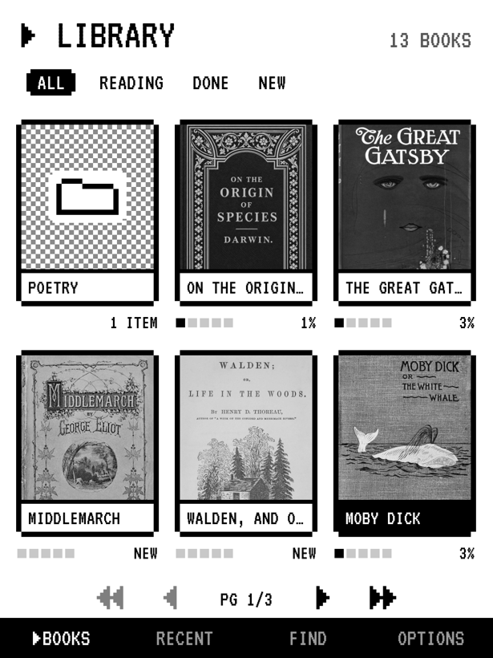
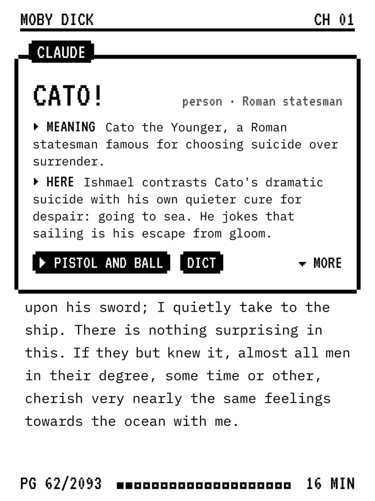
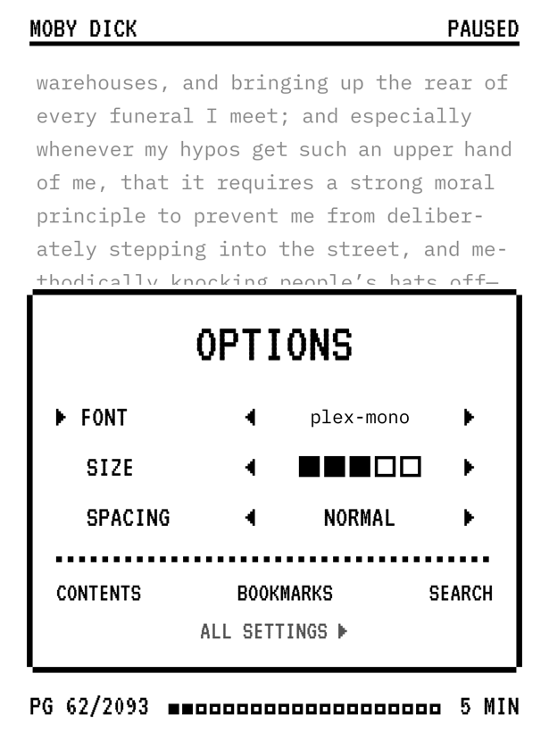
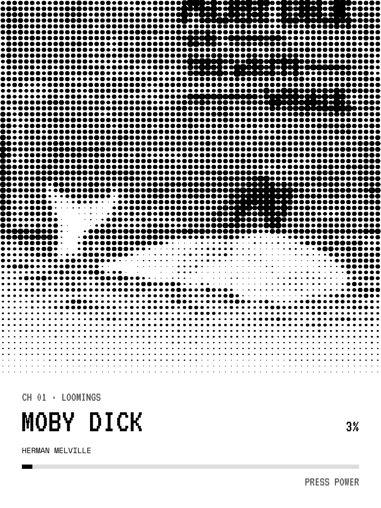

# KOReader Pixel

A fork of [KOReader](https://github.com/koreader/koreader) (the free, open-source
e-book reader for Kindle, Kobo and more) with a retro game-terminal look, and
**Explain**: long-press any word and Claude tells you what it means *in that
sentence of that book*.

| Library | Reading | Explain | Options | Sleep |
|---|---|---|---|---|
|  |  |  |  |  |

*Screenshots from the Mac simulator at Kindle Paperwhite resolution.*

> **Status:** tested in the Mac simulator only, not yet on a real Kindle.
> Based on KOReader nightly `v2026.07.2-311` (commit `4102790`). The original
> KOReader README is in [README.koreader.md](README.koreader.md).

## What it changes

- **Library:** book covers in rows of 3, each in a notched pixel frame with a
  title strip and a block progress bar. ALL / READING / DONE / NEW tabs, and a
  bottom bar with BOOKS / RECENT / FIND / OPTIONS. Books with no cover get a
  pixel pattern.
- **Reading:** IBM Plex Mono text, pixel chapter titles with a dashed rule, a
  header with the title and chapter, and a footer with the page, one square
  per page of the chapter, and minutes left.
- **Explain:** long-press a word. A "CLAUDE" box shows MEANING / HERE / DEEPER
  (tap ▼ MORE for DEEPER) and related words you can tap. DICT opens the normal dictionary. To
  explain a phrase, select several words and pick **Explain**.
- **OPTIONS** (tap the bottom of the page): font, size and spacing with ◀ ▶,
  plus CONTENTS / BOOKMARKS / SEARCH. ALL SETTINGS opens KOReader's full panel.
- **Sleep screen:** the title, an 8-bit version of the real cover, the chapter,
  and a progress bar.
- **Everything else:** pixel fonts, notched corners, pixel icons and capital
  letters on buttons across KOReader's menus and dialogs.

Every part can be switched off in **Settings > Pixel theme**.

## Try it on a Mac (Apple Silicon)

```sh
git clone https://github.com/AniketShahane/koreader-pixel.git
cd koreader-pixel
pixel/setup.sh      # downloads the matching KOReader builds + a few free books
pixel/run-mac.sh
```

- click = tap, click and hold = long-press, drag = swipe
- **F2** = power button (sleep screen), Page Up / Page Down = turn pages
- tap the top of a page for the menu, the bottom for OPTIONS

For Explain, run `export ANTHROPIC_API_KEY=sk-ant-...` first, or add a key in
**Settings > Pixel theme > Explain with Claude**.

## Put it on a Kindle

You need a jailbroken Kindle with KUAL and MRPI (see <https://kindlemodding.org>).

1. Download `koreader-pixel-kindlehf.zip` (firmware 5.16.3 or newer) or
   `koreader-pixel-kindlepw2.zip` (older firmware) from
   [Releases](https://github.com/AniketShahane/koreader-pixel/releases).
   You can also build them yourself: `pixel/deploy-kindle.sh` or `pixel/deploy-kindle.sh pw2`.
2. Unzip it onto the Kindle's root folder over USB (it adds `koreader/` and
   `extensions/`). Or plug the Kindle in and run `pixel/deploy-kindle.sh hf /Volumes/Kindle`.
3. On the Kindle, open **KUAL > KOReader**.
4. For Explain, put a text file named `claude_api_key.txt`, containing only
   your key, in the `koreader` folder on the Kindle.
5. Add **DRM-free** books (EPUB etc.) to `documents`. Books bought from Amazon are locked and won't open.

## Explain and Claude

- Each new word is one request to the Claude API: Claude Sonnet 5.5 by default,
  effort "low", answering as JSON that follows a fixed schema. You can switch to
  Opus 5.5 or Haiku 5.5 in the menu.
- Answers are saved per book and word, so looking a word up again is free and
  works offline.
- Requests send `fallbacks: "default"`: if a model declines, another one answers.
- Your key is read from `ANTHROPIC_API_KEY`, then from the settings, then from
  `koreader/claude_api_key.txt`.

## How it's built

All new code is in [`frontend/pixel/`](frontend/pixel) and
[`plugins/pixel.koplugin/`](plugins/pixel.koplugin). A few small hooks go into
stock files:

- `reader.lua`
- `frontend/apps/filemanager/filemanager.lua`
- `plugins/coverbrowser.koplugin/{main,mosaicmenu}.lua`
- `frontend/ui/screensaver.lua` and `frontend/ui/elements/screensaver_menu.lua`
- `frontend/ui/data/css_tweaks.lua`
- `frontend/ui/elements/*_menu_order.lua`
- pixel icons in `resources/icons/mdlight/`

The scripts don't compile anything. They lay these Lua files over an official
KOReader build of the **same** version (kept in the `base-…` release), for both
the Mac simulator and the Kindle package.

| Path | What |
|---|---|
| `pixel/setup.sh`, `run-mac.sh`, `deploy-kindle.sh`, `sync.sh` | download, run, package, overlay |
| `pixel/fonts/` | PixelTerm (VT323 plus pixel arrows and blocks), IBM Plex Mono, Space Mono, all under the SIL OFL |
| `pixel/tools/` | scripts that build the font and the icons |
| `pixel/dev/` | simulator remote control (`ko tap X Y`, `ko shot file.png`…), dev-only |

## License

AGPL-3.0, like KOReader (see [COPYING](COPYING)). The fonts are under the SIL Open Font License.
